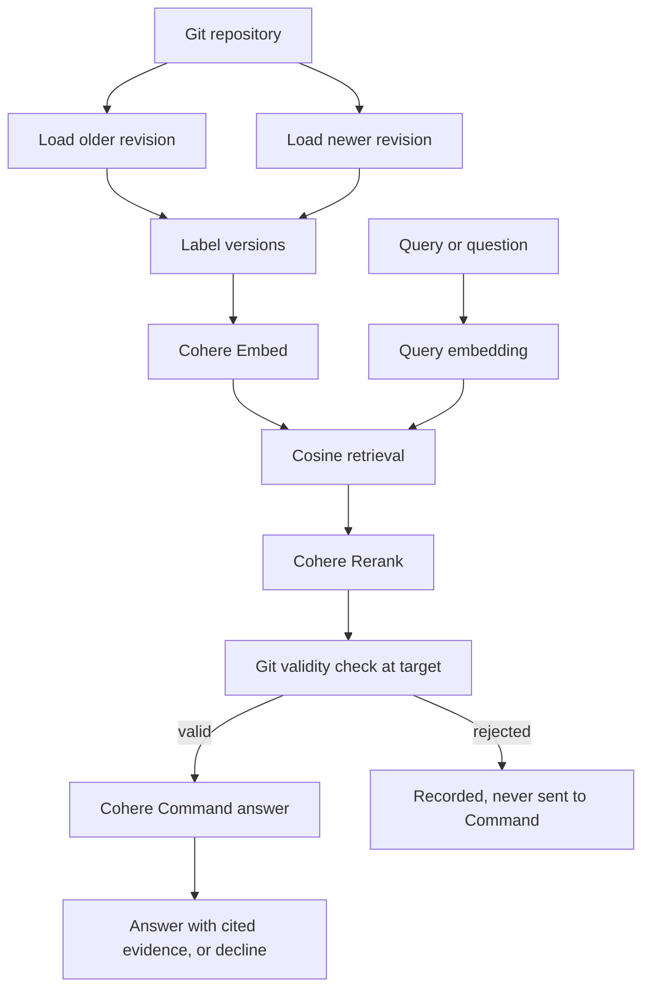

# System Architecture

## Status

Implemented and planned architecture for the version-aware retrieval prototype behind *Right Code, Wrong Version*.

Last updated: 22 November 2026 (D017). The earlier version of this document described the change-impact pipeline, which is now the foundation layer below.

## Design principle

Models rank and answer. Git decides what is valid.

Deterministic repository evidence is created and checked before a model reasons about it. Models are never the source of truth for which code exists, which version it belongs to, or whether it is valid at a commit.

## Version-aware pipeline



## Loading revisions

`src/cohere_workshops/versions.py`

`load_revision` reads files directly from a Git commit with `git ls-tree` and `git cat-file`, without checking the commit out. It applies the same safety rules as the working-tree scanner: ignored directories, sensitive file names, supported extensions, the 1,000,000-byte size limit and secret detection. Excluded files and processing errors are recorded.

Each accepted file is hashed with SHA-256 and split into the same deterministic chunks the scanner pipeline uses.

## Labelling versions

`label_versions` compares two revisions by code location: path, chunk kind, symbol and part index.

| Label | Meaning |
| --- | --- |
| current | the chunk at the newer revision |
| superseded | an older chunk whose location still exists but whose content changed |
| removed | an older chunk whose location no longer exists |

Older chunks identical to the newer revision are skipped, so each unchanged chunk is indexed once.

## Retrieval across versions

`src/cohere_workshops/version_search.py`, `cohere-versions`

Labelled chunks are embedded with `embed-v4.0` (`search_document`), and queries with `search_query`. Local cosine similarity ranks them. Retrieval runs at symbol level by default (functions, classes and methods) or at file level.

For each query, the output reports whether the top result is current, how many outdated chunks are in the top K, and the score gap between the best current and the best outdated result.

## Reranking and the Git filter

`src/cohere_workshops/rerank_versions.py`, `cohere-rerank`

`rerank-v4.0-pro` reorders the Embed candidates. The text Rerank reads has two formats:

- **code:** path, symbol and code;
- **metadata:** the same, plus revision, commit and commit date.

`check_ranking` then records whether stale code ranked above current code, whether current code is in the top K, and the stale share of the top K. `temporal_filter` removes stale chunks after Rerank.

This stage treats the newer revision as valid. The agent validates against any target, as described below.

## The read-only agent

`src/cohere_workshops/agent_tools.py`, `src/cohere_workshops/agent.py`, `cohere-agent`

### Search tool

`CodeSearchTool` exposes one tool to Command, `search_code`. Each call runs Embed, then Rerank, then the Git check, and returns only valid evidence. It never writes to the repository.

### Git validity check

`TargetValidator` loads the target commit, which may be either revision. A chunk is valid only if its location and content hash both exist at the target. Rejected chunks are recorded in the trace and never reach Command.

### Answering

`run_agent` works in two steps with the same Command model:

1. **Tool planning.** Command decides what to search for and may call `search_code` up to 3 times. If it never calls the tool, the app searches with the question.
2. **Answering.** Command answers from validated evidence only. A JSON Schema restricts the cited evidence IDs to chunks that passed the Git check. Command may decline when the evidence does not answer the question.

The default Command model is `command-a-plus-05-2026`. `--command-model` selects another; exploratory reruns use `command-a-03-2025` because of the Command A+ monthly limit.

### Stale-name check

`stale_references` flags an answer that names a rejected symbol. It skips names that also exist in valid code, so it cannot flag a superseded function that kept its name. It is a secondary signal; answer keys are the real check.

## Command-line interfaces

```bash
cohere-demo-repo
cohere-versions demo_repo --old v1 --new v2
cohere-rerank demo_repo --old v1 --new v2 --format both
cohere-agent demo_repo --old v1 --new v2 --target v1 --question "How is the transfer fee calculated?"
```

`cohere-demo-repo` creates the practice repository with tags `v1` and `v2`. The other three commands accept `--offline`, which uses fake clients and spends no credits.

## Records

Each command appends JSON Lines records: queries, ranks, scores, version labels, validity decisions, answers and citations. Records never contain API keys or embedding vectors.

`scripts/rerun_demo_experiments.py` runs all three stages on the practice repository and writes one folder per stage under `experiments/exploratory/`, with `raw-output.jsonl`, `console.txt` and `metadata.json`. A live run refuses to start when the working tree has uncommitted changes, so each record is tied to an exact application commit.

## Foundation layer

These components were built for the earlier change-impact design (D017). The version-aware pipeline reuses the first group directly.

Reused by the version-aware pipeline:

- `scanner.py`, `safety.py`: file discovery, exclusions and secret detection;
- `documents.py`: UTF-8 loading and SHA-256 hashing;
- `structure.py`: Python AST symbols, line ranges and imports;
- `chunks.py`, `corpus.py`: deterministic file and symbol chunks, capped at 12,000 characters, with stable identifiers;
- `embeddings.py`, `retrieval.py`, `reranking.py`: Cohere Embed, cosine retrieval and Cohere Rerank.

Kept, not used in this study's findings:

- `mapper.py`, `cohere-workshops`: repository map as JSON;
- `keyword.py`: BM25 retrieval (planned as a baseline once wired to two-revision corpora);
- `relationships.py`, `structural_retrieval.py`: one-hop import expansion;
- `semantic.py`, `prediction.py`, `ungrounded.py`, `cohere-search`: change-impact prediction, grounded and ungrounded;
- `dataset.py`, `manifest_writer.py`, `case_builder.py`, `git_ground_truth.py`, `cohere-dataset`, `cohere-case`: pull-request manifests and diff ground truth;
- `evaluation.py`: Recall@K, Precision@K, reciprocal rank and average precision over files.

## Deterministic and model-assisted boundaries

| Deterministic | Model-assisted |
| --- | --- |
| Reading revisions from Git | Query and chunk embeddings |
| Safety exclusions and hashing | Candidate reranking |
| Version labels | Choosing search queries |
| Validity at the target commit | Writing the answer |
| Restricting citable evidence | Choosing to decline |
| Ground truth and metrics | None of the ground truth |

## Security boundaries

- Cohere credentials stay in `.env`, which is excluded from Git and from scanning.
- Repository content reaches Cohere only through an explicit live command.
- Automated tests use fake clients and spend no credits.
- The agent's only tool is read-only search.
- Sensitive paths, oversized files and suspected secrets are excluded before any model call.
- Records and logs never contain API keys.

## Reproducibility

Every formal result must be traceable to the repository URL, both commits and their tree hashes, the target, the application commit, chunk identifiers, model names, settings, the experiment identifier, and the ground truth or answer key.

Exploratory runs are stored separately from the final evaluation (D016).

## Remaining architecture work

- Git filter in the Rerank stage validated against the target, not always the newer revision;
- per-location ranking metric (wrong-version above valid);
- BM25 over two-revision corpora;
- Command answering without retrieval, for questions;
- the agent without the Git filter, as an ablation;
- a manifest for commit-pair cases, queries and answer keys;
- an aggregate runner over the manifest;
- embedding caching, a dependency lock file and continuous integration;
- API usage recording.
